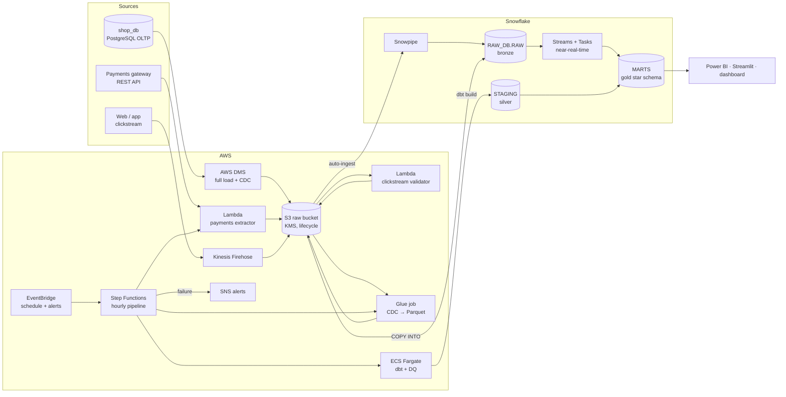
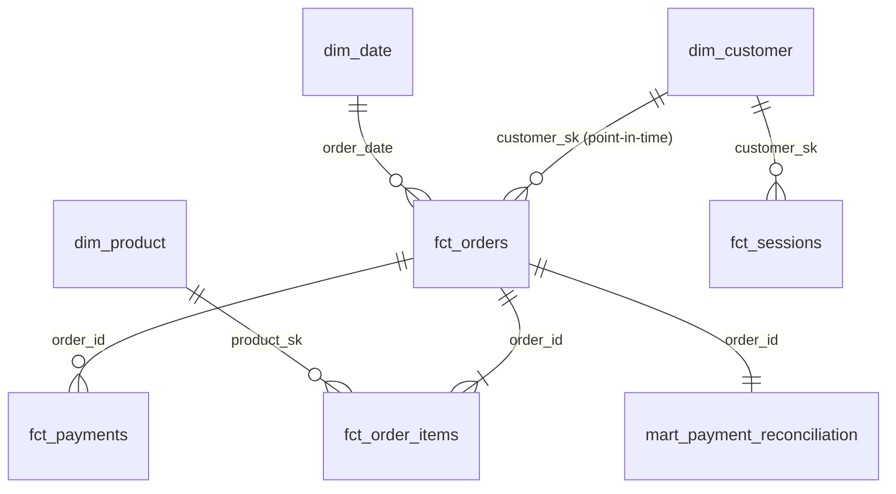

# ShopStream: an end-to-end retail data platform (Snowflake · AWS · dbt · Python)

ShopStream is a portfolio project: a complete, production-style data platform for an Indian e-commerce
retailer. It takes data from three source systems through ingestion, a Snowflake warehouse,
dbt modelling, data quality checks and reconciliation, and ends in BI reports. All of it is code, and
it runs end to end on a laptop (DuckDB stands in for Snowflake) with one command.

```bash
pip install -r requirements.txt
python run_local.py          # ~40 s: generate → extract → validate → load → dbt build → DQ → reconcile → BI export
```

## Architecture



| Layer | What happens | Where |
|---|---|---|
| **Sources** | OLTP orders/customers/products/items, payments API (nested JSON), clickstream (JSON events) | `data_generator/` |
| **Ingestion** | DMS CDC to S3 · paginated API extractor with retries + watermark · Lambda validator with quarantine + dedupe · Glue compaction | `ingestion/`, `infra/terraform/dms.tf` |
| **Loading** | Storage integration (IAM role, no keys) · COPY INTO with file metadata · Snowpipe auto-ingest · load audit | `snowflake/migrations/V1.0.3–V1.0.5`, `ingestion/snowflake_loader/` |
| **Near-real-time** | Stream on raw clickstream → serverless task graph (FLATTEN, MERGE sessions, finalizer) · dynamic table | `snowflake/migrations/V1.0.6` |
| **Transformation** | dbt: staging (CDC dedupe, VARIANT parsing) → intermediate (SCD2, sessionisation) → marts (star schema, incremental MERGE) | `dbt/` |
| **Data quality** | 60+ dbt tests · YAML rule framework (critical/warning) · source→raw→mart reconciliation · Snowflake DMFs + alerts | `data_quality/`, `dbt/tests/` |
| **Governance** | RBAC hierarchy, service users with key-pair auth, masking policies, row access policy, tags, secure views | `snowflake/migrations/V1.0.1`, `V1.1.0` |
| **Performance & cost** | Per-workload warehouses, resource monitors, clustering, search optimisation, QAS, query-history playbook | `snowflake/migrations/V1.0.0`, `snowflake/playbooks/` |
| **Orchestration** | Step Functions (retry/catch, Map over tables, parallel DQ) · EventBridge Scheduler · failure alerts | `orchestration/`, `infra/terraform/orchestration.tf` |
| **IaC & CI/CD** | Terraform (S3, KMS, IAM, Lambda, Glue, DMS, ECS, SFN, SNS) · GitHub Actions: lint, tests, e2e pipeline, dbt Slim CI, schemachange, OIDC deploy | `infra/`, `.github/workflows/` |
| **BI** | Executive, product, customer, finance and pipeline-health reports · Power BI model + DAX · Streamlit in Snowflake | `bi/`, `docs/powerbi_guide.md` |

## Data model (gold layer)



* `dim_customer` is **SCD Type 2** built from the CDC change log (every relocation is a new version).
  Facts join to the version **valid when the order was placed**.
* `fct_orders`, `fct_order_items` and `fct_sessions` are **incremental** (`MERGE` on Snowflake,
  `delete+insert` on DuckDB) with a 3-day lookback for late data; a post-hook propagates hard deletes.
* Reporting marts: `mart_daily_sales`, `mart_product_performance`, `mart_funnel_daily`,
  `mart_customer_rfm`, `mart_cohort_retention`, `mart_payment_reconciliation`.

## Real-world problems the pipeline handles

The generator deliberately injects the messy data that a real pipeline has to cope with:

| Problem | Where it is handled |
|---|---|
| DMS replays duplicate CDC rows after a task restart | `QUALIFY ROW_NUMBER()` in staging |
| Several updates to one order between loads | latest change per key (cdc_ts, then D > U > I) |
| Hard deletes in the source | `is_deleted` flag + fct post-hook delete |
| Customers relocate (history matters) | SCD2 from CDC + point-in-time fact joins |
| Malformed / duplicate / late clickstream events | Lambda quarantine + in-file dedupe, cross-file dedupe in dbt, lookback window |
| API rate limits (429/503) | exponential backoff with jitter, honours Retry-After |
| Re-running a load | COPY load metadata / `load_history` skip; watermark only advances after success |
| Payments that don't match orders | `mart_payment_reconciliation` + critical DQ threshold + daily alert |
| Missing / malformed emails | tracked as a warning KPI, masked as PII |

## Results of the local run

| Check | Result |
|---|---|
| dbt build | 25 models, 1 snapshot, 1 seed, 61 tests: **86 pass, 2 warn** (known source email issues) |
| Python unit tests | **14 pass** (validator, extractor retries/watermark, DQ engine, S3 via moto, loader SQL) |
| DQ framework | **11/11 rules pass** (reconciliation exception rate 0.43% vs 1% limit) |
| Reconciliation | **9/9 checks pass**: files, rows, events, payments, orders, lines, ₹ totals all tie out |
| Volumes | 126k CDC rows → 42k orders · 217k clickstream lines → 216k events → 58k sessions · 46.5k payments |

## Repository layout

```
data_generator/        synthetic OLTP CDC, payments API pages, clickstream (with injected DQ issues)
ingestion/             payments extractor, clickstream validator Lambda, Snowflake loader, Glue job
scripts/               local COPY INTO stand-in (DuckDB)
snowflake/migrations/  versioned DDL deployed by schemachange (warehouses → RBAC → stages → pipes → tasks → governance)
snowflake/post_dbt/    DMFs, alerts, secure views (run after dbt creates tables)
snowflake/playbooks/   performance tuning, cost, loading ops, governance audit, time travel / clone recovery
snowflake/streamlit/   Streamlit in Snowflake app
dbt/                   models (staging / intermediate / marts), snapshots, macros (cross-db), tests
data_quality/          YAML DQ framework + reconciliation (DuckDB or Snowflake)
orchestration/         Step Functions state machine (ASL)
infra/terraform/       AWS infrastructure
docker/                dbt / DQ runner image for ECS Fargate
.github/workflows/     CI (lint, tests, e2e, Slim CI, terraform validate) and deploy (OIDC)
bi/                    BI dataset export, dashboard page, CSV extracts
docs/                  architecture decisions, Power BI guide, runbook, interview guide
```

## Running against real Snowflake + AWS

1. `terraform -chdir=infra/terraform apply -var-file=dev.tfvars` (copy `dev.tfvars.example`).
2. Run `snowflake/migrations` in order (or `schemachange deploy -f snowflake/migrations`), paste the
   storage-integration IAM user/external ID and the Snowpipe SQS ARN back into Terraform, then apply again.
3. `cd dbt && dbt build --target dev` (SSO) or `--target prod` (key-pair).
4. Run `snowflake/post_dbt/` once; the Step Functions schedule takes over hourly.

**What was and was not executed:** the local path (generator, extractor, validator, loader, every dbt model
and test, DQ, reconciliation, BI export, unit tests) was run end to end. The Snowflake SQL, Terraform,
Step Functions definition, Glue job and GitHub workflows are written against the real services but were
not deployed here, because there is no Snowflake or AWS account in this environment. CI runs `terraform validate`.
